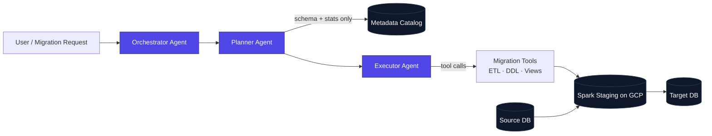

  
  
  
  

---

## 👋 About me

I'm an **AI Engineer** with 1.5 years of experience shipping **production multi-agent and RAG systems** for enterprise clients. I care about the unglamorous parts that make agents usable in the real world: security boundaries, idempotency, evaluation, and observability.

- 🏢 **Junior Software Developer @ [Indium Software](https://www.indiumsoftware.com/)** — building **Data Lifter**, an autonomous Google ADK multi-agent system that migrates databases across engines
- 🧠 Focus areas: **multi-agent orchestration · agentic RAG · LLM evaluation · data platforms (Databricks, Spark)**
- 🌍 Open source: contributions to **Google ADK**, **Apache Superset** and **Agno**
- 🎓 B.Tech CSE (Information Security), **VIT Vellore**
- 🥁 Off the keyboard: classical **tabla** player and **roller skater** 🛼

---

## 🛠️ What I've built at work

<table>
<tr>
<td width="50%" valign="top">

### 🔄 Data Lifter — Indium Software
Autonomous **Google ADK** multi-agent system that migrates databases across engines (e.g. PostgreSQL → Oracle), generating ETL pipelines, views and scripts, and running data ops in flight.

- 🔒 **Zero-data-exposure design**: agents plan and act via metadata and tool calls, so row-level data never reaches the LLM — built for regulated enterprise clients
- ⚡ **3× faster** migrations (5M rows: 90s → 30s) using Google Cloud + Apache Spark as the staging layer

</td>
<td width="50%" valign="top">

### 🧭 Databricks Agent Layer — Indium Software
AI agent layer over **Databricks Unity Catalog** that lets custom Genie-like agents use ontology, business semantics, relationships and governed data for **natural-language analytics and SQL generation**.

### 🏗️ Enterprise Multi-Agent Platform
Agent workflows in **LangGraph** (stateful graphs, conditional routing) and **LangChain** (tool calling, retrieval) on **Azure AI Foundry**, Azure SQL and Cosmos DB.

</td>
</tr>
</table>

<b>How the zero-data-exposure pattern works</b>

 

The LLM-driven agents (purple) only ever see metadata and tool results. Row-level data moves between the data stores (dark) without passing through a model.

**Before Indium — Cymake Inc. (Ravan AI):** AI ad/video generation pipeline orchestrating LLMs, diffusion, TTS and lip-sync models over async queues (**70% faster creation, 4× throughput**) · n8n automations integrating 50+ tools with LLM-driven routing (**60% less ops effort**) · RAG pipelines on Pinecone/Weaviate/FAISS · multi-tenant Django microservices with RBAC.

---

## 🚀 Featured projects

<table>
<tr>
<td width="50%" valign="top">

### 📚 [Ask the Docs](https://github.com/devansh173/ask-the-docs)
**Agentic RAG** as a LangGraph state machine: grades retrieval, rewrites and re-searches weak queries, and checks answer groundedness against citations. Works with Claude, Gemini, GPT and Ollama.

| Metric | Naive RAG | Agentic RAG |
|---|:---:|:---:|
| RAGAS faithfulness | 0.885 | **1.0** |
| Answer relevancy | 0.525 | **0.882** |
| Hit@1 (hybrid dense + BM25, RRF) | 0.875 | **1.0** |

`LangGraph` `Qdrant` `FastAPI` `RAGAS` `Langfuse` `Docker`

</td>
<td width="50%" valign="top">

### 🔁 [OraShift](https://github.com/devansh173/orashift)
LLM-powered **Oracle → PostgreSQL SQL translation**, with Oracle Free and Postgres running locally in Docker to validate translated SQL against real engines.

`Python` `LLMs` `Oracle` `PostgreSQL` `Docker`

### 🚗 [Neural Autonomous Driving Simulator](https://github.com/devansh173/neural-autonomous-driving-simulator)
Neural network written **from scratch (no ML frameworks)** that drives a car using 7 ray-cast sensors, trained by a **genetic algorithm** with elitism, crossover and adaptive mutation.

`Python` `NumPy-free NN` `Pygame` `Genetic Algorithms`

</td>
</tr>
</table>

---

## 🌍 Open source contributions

| Project | Contribution | Status |
|---|---|:---:|
|  **[Google ADK](https://github.com/google/adk-python)** | Fixed Pub/Sub & Eventarc redeliveries re-running agents and repeating tool side effects (e.g. double payments) by exposing delivery IDs as idempotency keys. Backwards compatible, 7 unit tests. [#7325](https://github.com/google/adk-python/pull/7325) |  |
|  **[ADK Docs](https://github.com/google/adk-docs)** | Documented dead-letter and dedup setup for event-driven agents. [#2274](https://github.com/google/adk-docs/pull/2274) · [#2275](https://github.com/google/adk-docs/pull/2275) |  |
|  **[Apache Superset](https://github.com/apache/superset)** | Matched server-side report number formatting to d3-format so negative-zero renders consistently. [#44644](https://github.com/apache/superset/pull/44644) |  |
|  **[Apache Superset](https://github.com/apache/superset)** | Fixed `cast_to_num` crashing on Unicode non-decimal digits. [#44615](https://github.com/apache/superset/pull/44615) |  |
|  **[Agno](https://github.com/agno-agi/agno)** | Preserved MCP audio tool output as agent artifacts, with base64 validation and tests. [#10036](https://github.com/agno-agi/agno/pull/10036) |  |

Status badges update automatically from GitHub.

---

## 🧰 Tech stack

**LLMs & Agents**

  
  
  
  
  
  
  
  
  
  

**RAG & Evaluation**

  
  
  
  
  
  

**Data Platforms**

  
  
  
  
  
  

**Backend & Cloud**

  

---

## 🏅 Certifications

| | Certification |
|:---:|---|
| 🟠 | **Claude Certified Architect (CCA-F)** — Anthropic |
| 🔴 | **Databricks Certified Generative AI Engineer Associate** |
| 🟡 | **AWS Certified Cloud Practitioner** |

---

## 📊 GitHub activity

  

  
  

---

**Open to AI Engineer · Forward Deployed Engineer · SDE roles** — let's talk about agents that actually ship.  
<a href="mailto:bdevansh173@gmail.com">bdevansh173@gmail.com</a>

